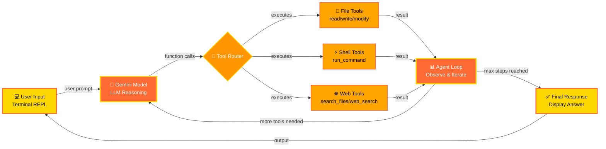

<div align="center">


  

</div>

A terminal-based agentic CLI powered by Google Gemini. Reads/writes files, runs shell commands, and searches the web through a ReAct agent loop — all from your terminal.

---

## Architecture



---

## Features

- **ReAct agent loop** — the model reasons, calls tools, observes results, and iterates
- **Native streaming** via `@google/generative-ai` SDK with function calling
- **Modular tool system** — add a new tool in two files
- **Interactive REPL** with `/help`, `/clear`, `/history`, `/exit`, and more
- **Safety layer** — blocked command patterns and protected paths
- **`--yolo` flag** — auto-approve all actions (use with care)
- **Knowledge Base** — role files for domain-specific context

---

## Getting Started

### Prerequisites

- Node.js ≥ 18
- pnpm (`npm install -g pnpm`)
- A [Google Gemini API key](https://aistudio.google.com/app/apikey)

### Installation

```bash
git clone https://github.com/UdaySharmaGitHub/Agentic-cli.git agentic-cli
cd agentic-cli
pnpm install --allow-build=esbuild
cp .env.example .env
# Edit .env and add your GEMINI_API_KEY
```

### Running

```bash
# Development (live reload)
pnpm dev

# Production build then run
pnpm build
node dist/index.js
```

---

## Tools

| Tool | Description |
|------|-------------|
| `read_file` | Read a file |
| `write_file` | Write/overwrite a file |
| `append_file` | Append to a file |
| `modify_file` | Replace text inside a file |
| `list_dir` | List directory contents |
| `search_files` | Recursively search for files by name |
| `run_command` | Execute a shell command |
| `web_search` | Search the web (Brave or Tavily) |

---

## Adding a New Tool

**Step 1 — Create the module** in `src/tools/`:

```typescript
// src/tools/myTool.ts
import type { ToolDefinition } from "./types.js";

export const myTool: ToolDefinition = {
  name: "my_tool",
  description: "What my tool does.",
  parameters: {
    type: "object",
    properties: {
      input: { type: "string", description: "The input." },
    },
    required: ["input"],
  },
  async execute(args) {
    const input = String(args["input"]);
    return { success: true, output: `Received: ${input}` };
  },
};
```

**Step 2 — Register it** in `src/tools/index.ts`:

```typescript
export { myTool } from "./myTool.js";
```

Then add `myTool` to the `TOOLS` array in `src/index.ts`.

---

## Environment Variables

| Variable | Required | Description |
|----------|----------|-------------|
| `GEMINI_API_KEY` | Yes | Google Gemini API key |
| `BRAVE_API_KEY` | No | Brave Search API key for web search |
| `TAVILY_API_KEY` | No | Tavily API key for web search |

Copy `.env.example` to `.env` — never commit your `.env` file.

---

## REPL Commands

| Command | Description |
|---------|-------------|
| `/help` | Show available commands |
| `/clear` | Clear the terminal |
| `/exit` or `/quit` | Exit the REPL |
| `/history` | Show conversation history |
| `/status` | Show model and tool status |
| `/raw` | Toggle raw JSON output |

---

## Contributing

Contributions are welcome! Please read [CONTRIBUTING.md](CONTRIBUTING.md) for branch naming,
commit format, and PR guidelines. Report bugs via the [Bug Report](.github/ISSUE_TEMPLATE/bug_report.md)
template and report security issues privately via [SECURITY.md](SECURITY.md).

---

## License

MIT — see [LICENSE](LICENSE).
